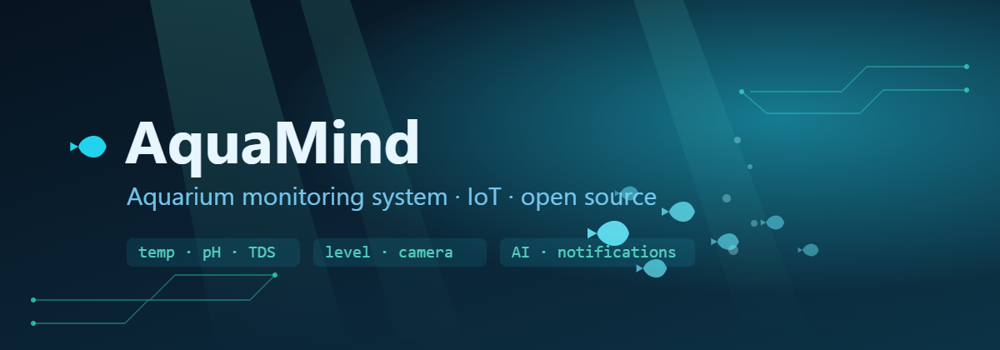
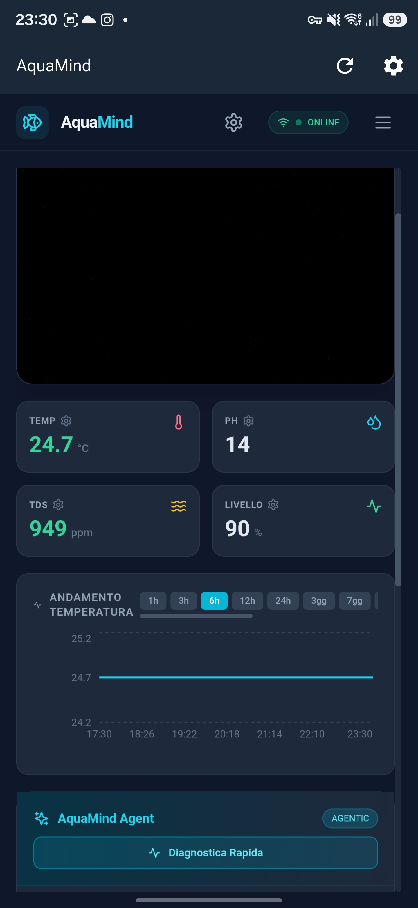
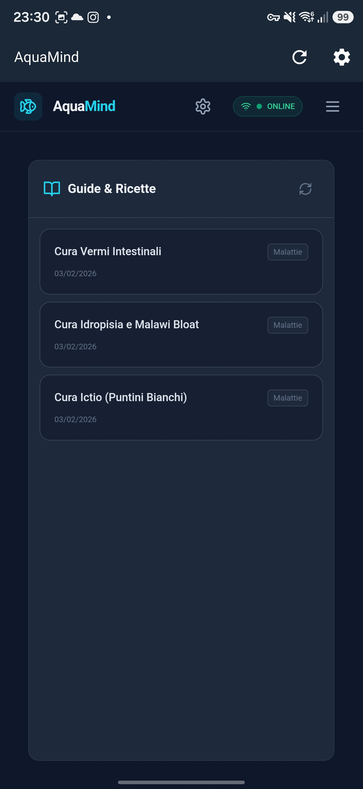
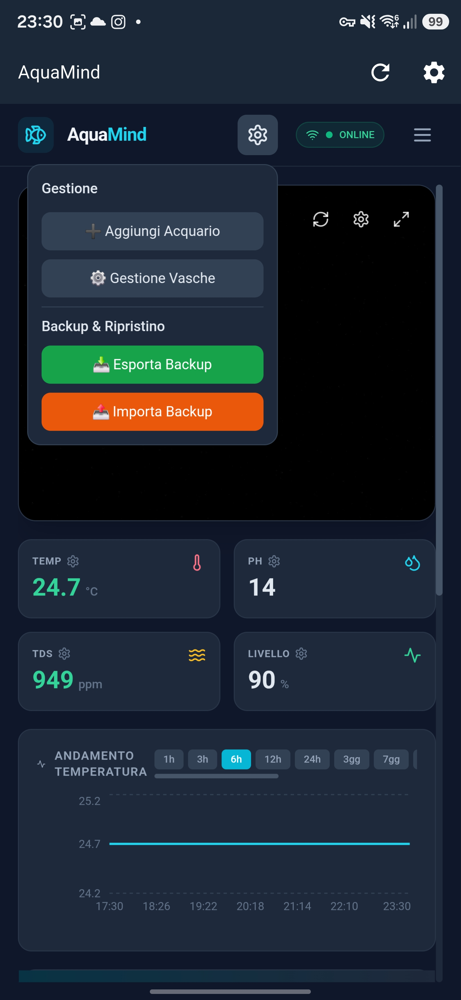
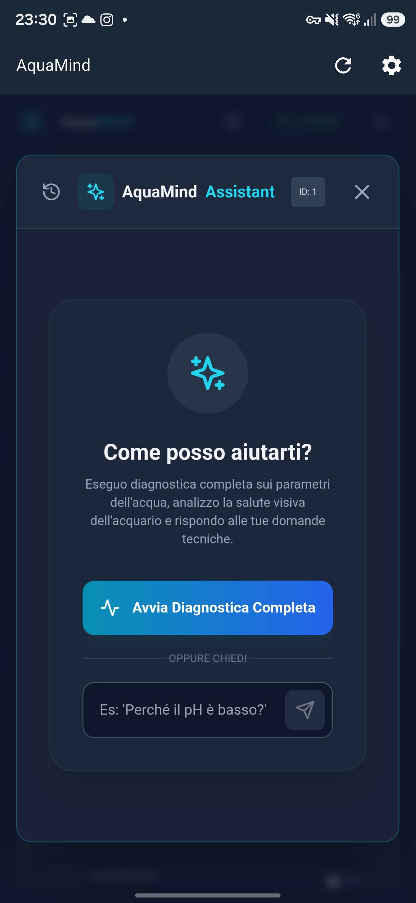
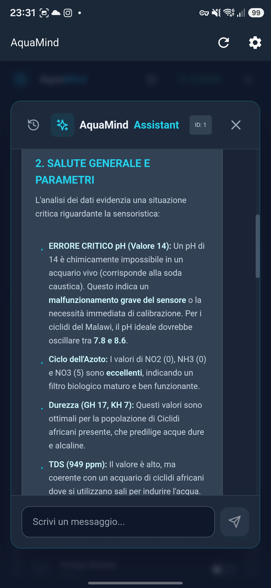
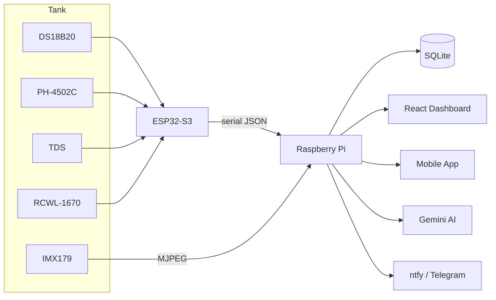

<p align="center">
  
</p>

<p align="center">
  <strong>The brain of your aquarium. 🐟</strong><br>
  Real-time monitoring: <strong>temp, pH, TDS, level, camera, AI, notifications</strong>.
</p>

<p align="center">
  <strong>🇬🇧 English</strong> · <a href="README_it.md"><strong>🇮🇹 Italiano</strong></a>
</p>

<p align="center">
  
  
  
  
  
  <a href="https://pcbway.com"></a>
</p>

<p align="center">
  <sub>
  <a href="#-features">Features</a> ·
  <a href="#-web-ui-react-dashboard">Web UI</a> ·
  <a href="#-mobile-app">Mobile app</a> ·
  <a href="#-architecture">Architecture</a> ·
  <a href="#-repository-structure">Contents</a> ·
  <a href="#-3d-models-renders">3D models</a> ·
  <a href="#-quick-start">Quick start</a> ·
  <a href="#-api">API</a> ·
  <a href="#-components">Components</a> ·
  <a href="#-sponsor--pcbway">Sponsor · PCBWay</a>
  </sub>
</p>

---

# 🇬🇧 AquaMind

## 🏭 Sponsor · PCBWay

<p align="center">
  <a href="https://pcbway.com"></a>
</p>

A big thanks to  **[PCBWay](https://pcbway.com)** for supporting the project and taking care of the PCB fabrication for AquaMind.
They manufactured the AquaMind board directly from the Gerber files and production data available in pcb/kicad/.
I was really happy with how the board turned out. The overall finish was very clean, the silkscreen was sharp, and the drilling and routing looked precise.

Having the real PCB in hand was also really useful because it allowed me to check things that are difficult to judge only from KiCad, especially connector placement, spacing, mounting points, and the JST footprints.

The whole production process was straightforward, and the board arrived quickly and well made. Most importantly, the final result matched the design very closely, which gave me much more confidence in the hardware.
Overall, I had a very positive experience with PCBWay. Seeing AquaMind go from a PCB layout on screen to a real, professionally manufactured board was one of the most satisfying parts of the project.

Thanks again to PCBWay for supporting AquaMind and helping turn the design into a real PCB.

- 📂 Fab-ready Gerbers: `pcb/kicad/gerber/`
- 📋 BOM + positions + IPC netlist: `pcb/kicad/production/`
- 🧊 3D model of the board: `pcb/kicad/AquaMind.step`

Want to build the board? Upload the Gerber set to PCBWay — the project thanks
everyone who supports the hardware pipeline. 🐟

---

## 🐟 What is AquaMind

**AquaMind** is a complete, open-source system for monitoring and controlling a
fish tank. A microcontroller reads the submerged sensors, a Raspberry Pi acts as the
central brain (history, video, AI and notifications) and a web dashboard + mobile app
let you keep an eye on everything, even from afar.

The project covers **the entire chain**: from the sensor firmware, to the custom PCB,
to the 3D-printed case, all the way to the Docker backend and the React frontend.

### 📸 The built prototype · 3D-printed case + custom PCB

A photo tour of the **physically built prototype**: PCB fabricated by PCBWay, 3D-printed enclosure and all the components. **Click any photo to open it full size.**

<table>
  <tr>
    <td align="center"><a href="images/proto_01.jpg"></a><br><sub>🏭 PCB fabricated by PCBWay</sub></td>
    <td align="center"><a href="images/proto_02.jpg"></a><br><sub>🧩 Components &amp; JST connectors</sub></td>
    <td align="center"><a href="images/proto_03.jpg"></a><br><sub>🔌 Wired sensors + ESP32</sub></td>
  </tr>
  <tr>
    <td align="center"><a href="images/proto_04.jpg"></a><br><sub>🧊 3D-printed enclosure + PCB</sub></td>
    <td align="center"><a href="images/proto_05.jpg"></a><br><sub>🖥️ Enclosure with OLED display</sub></td>
    <td align="center"><a href="images/proto_06.jpg"></a><br><sub>🐟 3D-printed lid "AQUAMIND"</sub></td>
  </tr>
  <tr>
    <td align="center"><a href="images/proto_07.jpg"></a><br><sub>🏷️ Front panel · TEMP · PH · TDS · LEVEL</sub></td>
    <td align="center"><a href="images/proto_08.jpg"></a><br><sub>📂 Open enclosure, PCB inside</sub></td>
    <td align="center"><a href="images/proto_09.jpg"></a><br><sub>🐠 The prototype in the aquarium</sub></td>
  </tr>
</table>

### ⚙️ Features

| Area | What it does |
|------|-------------|
| 📷 **Video** | **IMX179** camera (8MP, 1080p) inside a **repurposed transparent garden sphere**, live MJPEG streaming |
| 💡 **Controls** | Lights, pump, skimmer, heater, feeder — from web and app |
| 📅 **Scheduler** | Automatic on/off schedules for every device |
| 🤖 **AI** | **Google Gemini** integration for diagnostics and control |
| 🔔 **Notifications** | **ntfy** and **Telegram** alerts when a parameter goes out of range |
| 📈 **History** | Archived data with browsable history (`/sensors/history` API) |
| 🖥️ **Web UI** | **React + Vite + Tailwind** dashboard served by Nginx |
| 📱 **Mobile app** | Android app riding on the **same REST API** (sensors, video, AI, guides, backup) |
| 🧩 **Home Assistant** | Custom component for **Chihiros** lights (BLE) |

---

## 🖥️ Web UI (React dashboard)

The React dashboard is the control center: live video from the underwater sphere,
real-time sensor cards, AI agent, manual controls, schedules, maintenance calendar,
fish inventory and full history. **Click any screenshot to open it full size.**

<table>
  <tr>
    <td align="center" colspan="2"><a href="images/ui_01_dashboard.png"></a><br><sub>📷 <b>Dashboard</b> — live video, sensors (TEMP · PH · TDS · LEVEL), AquaMind AI agent, manual controls</sub></td>
  </tr>
  <tr>
    <td align="center"><a href="images/ui_02_maintenance.png"></a><br><sub>📅 <b>Maintenance</b> — calendar with scheduled water changes and events</sub></td>
    <td align="center"><a href="images/ui_03_water_params.png"></a><br><sub>💧 <b>Water parameters</b> — full analysis, hardness, complete recipe</sub></td>
  </tr>
  <tr>
    <td align="center"><a href="images/ui_04_fish.png"></a><br><sub>🐠 <b>Fish inventory</b> — species, quantity, food and last feeding</sub></td>
    <td align="center"><a href="images/ui_05_history.png"></a><br><sub>📈 <b>History</b> — telemetry charts with min/max/avg statistics</sub></td>
  </tr>
</table>

---

## 📱 Mobile app

The **Android app** rides on the same REST API as the dashboard: sensor cards, live video,
AI assistant, treatment guides, tank management and backup — right from the phone.
**Tap any screenshot to open it full size.**

<table>
  <tr>
    <td align="center"><a href="images/Screenshot_20261013_233030.jpg"></a><br><sub>🏠 <b>Home</b> — sensor cards (TEMP · PH · TDS · LEVEL), trend charts, AI agent</sub></td>
    <td align="center"><a href="images/Screenshot_20261013_233012.jpg"></a><br><sub>📖 <b>Guides &amp; recipes</b> — disease treatments saved per tank</sub></td>
    <td align="center"><a href="images/Screenshot_20261013_233021.jpg"></a><br><sub>⚙️ <b>Management</b> — add aquarium, tank manager, backup export/import</sub></td>
    <td align="center"><a href="images/Screenshot_20261013_233038.jpg"></a><br><sub>🤖 <b>AI Assistant</b> — Gemini chat, quick diagnostic</sub></td>
    <td align="center"><a href="images/Screenshot_20261013_233149.jpg"></a><br><sub>🩺 <b>Full diagnostic</b> — pH, nitrogen cycle, GH/KH, TDS, fish compatibility</sub></td>
  </tr>
</table>

All 12 app screenshots are in [`images/`](images/).

---

## 🧠 Architecture

The flow is simple: the **ESP32-S3** reads the sensors and publishes them as JSON over
serial; the **Raspberry Pi** (in Docker) receives and stores them, acts as the hub for
video and controls, and pushes events to the dashboard, the app and the notification
channels.



---

## 📦 Repository structure

The repo is organized in 4 areas, one per "layer" of the project:

```
.
├── 3D/
│   ├── case/            #    Enclosure: base, lid, sensor mounts, spacer, cap
│   ├── display/         #    display_aquamind + 53 mm glass mount (SLDPRT/STEP)
│   └── completo/        #    Main assemblies as GLB (viewable in the browser)
├── codice/
│   ├── esp32-s3/        # Sensor firmware (ESP32-S3, v2.0.0-S3)
│   └── raspberry/       # Full dockerized system (backend + frontend)
│       ├── backend/     #   Node.js: API, history, video, AI, notifications, Chihiros
│       ├── frontend/    #   React + Vite + Tailwind (dashboard)
│       ├── docs/        #   Setup notes (Bluetooth, etc.)
│       └── docker-compose.yml
├── pcb/
│   └── kicad/           # KiCad project: sch, pcb, gerber, BOM, netlist, positions
│       ├── gerber/      #   Production files (fab-ready)
│       └── production/  #   BOM, designators, IPC netlist, positions
├── rendering/           # Full-system renderings
├── images/              # Built-prototype photos · Web UI screens · mobile app screens
└── docs/                # Page images and banner
```

### 🧊 1 · Case and 3D models

The mechanics are designed in **SolidWorks** (`.SLDPRT` sources) and exported as
**STEP** (neutral format for CAD/verification). In the repo you will find:

- **`3D/case/`** — the complete enclosure: base, lid, sensor mounts, spacer, cap and
  the full assembly (`AquaMind.step`).
- **`3D/display/`** — the **display housing** (`display_aquamind`) and the **53 mm
  glass mount**, the bracket that fixes the camera sphere to the tank glass.
- **`3D/completo/`** — the **main assemblies as GLB**, viewable directly in the
  browser.

> 💡 `.SLDPRT` are the SolidWorks sources, `.STEP` is the neutral exchange format.

### 🔲 2 · Sensor firmware (ESP32-S3)

`codice/esp32-s3/Aquamind-s3.ino` — firmware that reads the 4 sensors and publishes
them as JSON over serial/UART every 2 seconds, with a **local OLED display** and
**EEPROM-based calibration** (pH offset, TDS coefficient, level range).

- **DS18B20** → temperature (OneWire)
- **PH-4502C** → pH (ADC)
- **TDS** → salinity (ADC)
- **RCWL-1670** → water level (mmWave)
- **SSD1306** → 128×64 OLED display (I²C)

### 🍓 3 · Raspberry Pi system (Docker)

`codice/raspberry/` is the complete **dockerized** system (backend + frontend in
containers):

- **`backend/`** — **Node.js** server: REST API, serial ingest, MJPEG video streaming,
  SQLite history, controls, scheduler, **Gemini AI** proxy, **ntfy/Telegram**
  notifications and a daemon for the **Chihiros** lights (BLE).
- **`frontend/`** — **React + Vite + Tailwind** dashboard, served by **Nginx**.
- **`docker-compose.yml`** — orchestrates the two services (backend on `host`
  network for USB/BLE, frontend on port 80).
#### What the backend does (subsystems)

| Subsystem | How it works |
|----------------|---------------|
| **REST API** | Express (`server.js`) exposes the `/api/*` endpoints for the dashboard and the mobile app |
| **WebSocket** | `ws` on `/ws` → live push of sensors, device states and alerts to the dashboard |
| **Serial ingest** | `serialport` reads the JSON frames from the ESP32; one port per tank (`tankSerialPorts`) |
| **History** | `better-sqlite3` with `sensors`, `alert_log`, `schedules`, `chihiros_devices`, `maintenance_log`, `water_parameters`, `fish_inventory` tables (+ auto migrations) |
| **Video** | `child_process` + `ffmpeg` → MJPEG stream from `/dev/video0` (`/api/stream`) |
| **Scheduler** | Automatic device on/off, with active-devices lookup (`/api/schedules/active-devices`) |
| **Alerts** | Configurable thresholds and deltas, event log, notification test (`/api/alerts/*`) |
| **Notifications** | Push to **ntfy** and **Telegram** when a parameter goes out of range |
| **Chihiros BLE** | Python daemon (`chihiros_daemon.py` + `bleak`) handles scan, on/off, brightness, RGB, channels, schedules and auto-mode |
| **AI** | **Gemini** proxy (`/api/gemini`) with saved conversations and recipes |
| **Multi-tank** | Tank CRUD, remote calibration, camera settings, config export/import |
| **Firmware** | ESP32 firmware flashing over serial upload (`/api/tanks/:id/firmware`) |
| **Backup** | Database export/import (`/api/backup`, `/api/restore`) |

<details>
<summary><b>Quick start</b></summary>

```bash
cd codice/raspberry
cp backend/.env.example backend/.env   # add GEMINI_API_KEY, tokens, etc.
docker-compose build
docker-compose up -d
# Dashboard: http://<raspberry-ip>/
```

</details>

### 🛠️ 4 · PCB (KiCad)

`pcb/kicad/` contains the complete **KiCad** project of the AquaMind board:

- `AquaMind.kicad_sch` / `AquaMind.kicad_pcb` — schematic and PCB layout (2 layers)
- `gerber/` — complete production set (Cu, mask, silkscreen, paste, edge cuts, drill)
- `production/` — **BOM**, **designators**, **IPC netlist** and **positions** for
 manufacturing
- `AquaMind.step` — 3D model of the PCB

> ℹ️ In the BOM the board uses the **ESP32-C3 SuperMini** module (`U1`); the firmware
> in `codice/esp32-s3/Aquamind-s3.ino` is written for the **ESP32-S3 DevKit** — pins
> are configurable at the top of the file.

> 🏭 **The PCBs of this project are fabricated by [PCBWay](https://pcbway.com)** —
> the files in `gerber/` and `production/` are fab-order ready.

## 🧊 3D models (renders)

Renders of the **CAD 3D models** (from the GLB assemblies in `3D/`) — these are **not**
photos of the built hardware, the physical prototype is in the section above:

<table>
  <tr>
    <td align="center"><a href="docs/model_board.png"></a><br><sub>🧊 Board + sensors assembly</sub></td>
    <td align="center"><a href="docs/model_camera.png"></a><br><sub>📷 Camera sphere + 53 mm mount</sub></td>
    <td align="center"><a href="docs/model_pcb.png"></a><br><sub>🛠️ AquaMind PCB</sub></td>
  </tr>
</table>

### 📷 The underwater sphere

To house the camera underwater, a **transparent garden sphere** was purchased — one of
those solar-panel LED globes used for garden lighting — and **repurposed** for this
purpose: inside it sits the **IMX179** camera (8 MP, 1080p, 1/3.2″ CMOS), and the
sphere is fixed to the tank glass with the **53 mm mount** (sources in `3D/display/`).

<p align="center">
  
</p>

---

## 🚀 Quick start

```bash
# 1. Clone the repo
git clone https://github.com/<your-username>/AquaMind.git
cd AquaMind

# 2. Start the Raspberry system (Docker)
cd codice/raspberry
cp backend/.env.example backend/.env
docker-compose build && docker-compose up -d

# 3. Flash the ESP32-S3 firmware (from Arduino IDE)
#    Board: ESP32S3 Dev Module · Port: /dev/ttyUSB*
```

Open the dashboard at `http://<raspberry-ip>` and you are up and running. 🐠

---

## 🔌 API

| Endpoint | Method | Description |
|----------|--------|-------------|
| `/api/sensors` | GET | Current sensor data |
| `/api/sensors/history?hours=24` | GET | Data history |
| `/api/controls` | GET / POST | Device state / control |
| `/api/schedules` | GET / POST | Schedules |
| `/api/schedules/:id` | PUT / DELETE | Update / delete schedule |
| `/api/stream` | GET | MJPEG video stream |
| `/api/status` | GET | System status |
| `/api/gemini` | POST | Gemini AI proxy |

Example:

```bash
curl http://raspberry/api/sensors
# {"temp":25.4,"ph":8.2,"tds":120,"level":98,"fw_version":"2.0.0-S3"}

curl -X POST http://raspberry/api/controls \
  -H "Content-Type: application/json" \
  -d '{"device":"mainLight","state":true}'
```

---

## 🖼️ Components

The hardware components at the heart of the project:

| | | |
|:---:|:---:|:---:|
|  |  |  |
| 🎥 **IMX179** — 8MP camera<br>night-vision in the underwater sphere | 🧪 **TDS** — salinity probe<br>ADC, EEPROM calibration | 🔬 **PH-4502C** — pH probe<br>ADC, EEPROM offset |
 |  |  |  |
| 🌡️ **DS18B20** — temperature probe<br>OneWire bus | 📶 **RCWL-1670** — mmWave module<br>water-level detection | 🖥️ **OLED SSD1306** — local display<br>128×64 I²C |
|  |  | |
| 🧠 **ESP32-S3** — microcontroller<br>sensor reading + OLED | 🍓 **Raspberry Pi** — central hub<br>API, history, video, AI | |

---

## 📄 License

[MIT](LICENSE) — fork it, improve it, share it. 🐟
