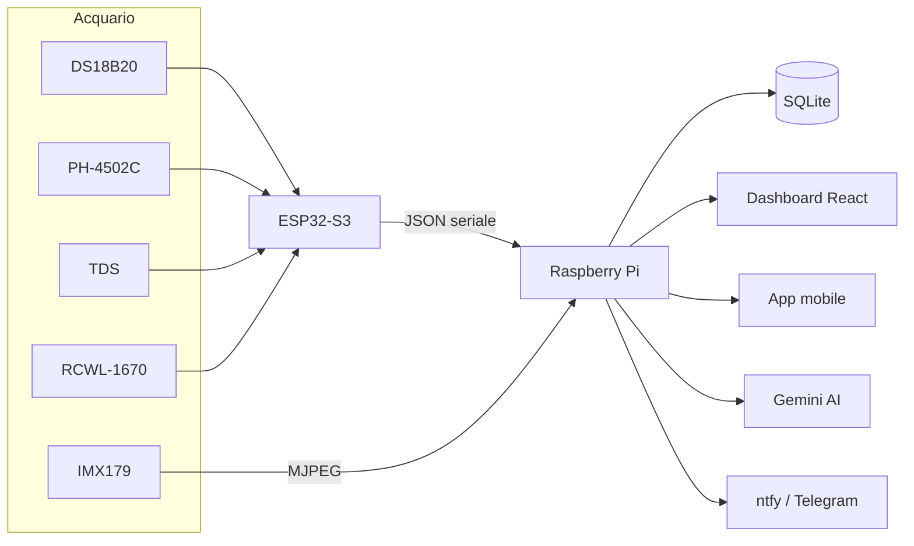
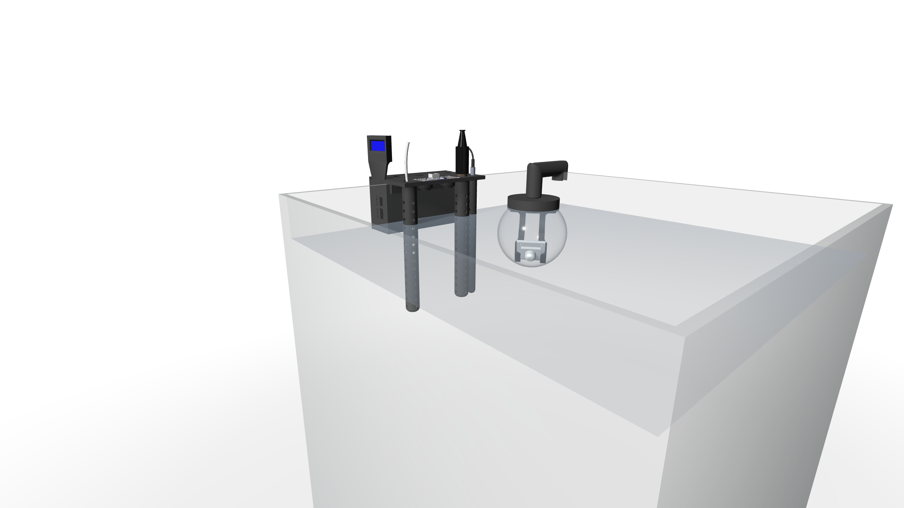
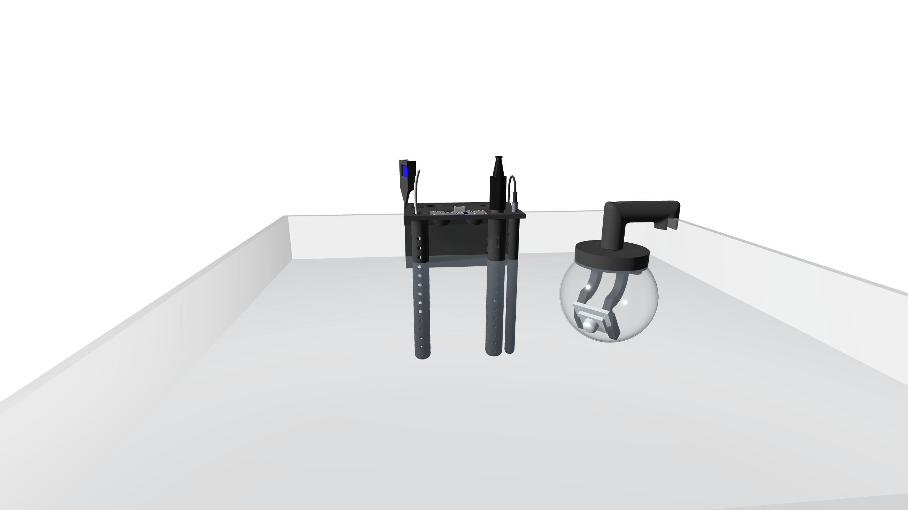
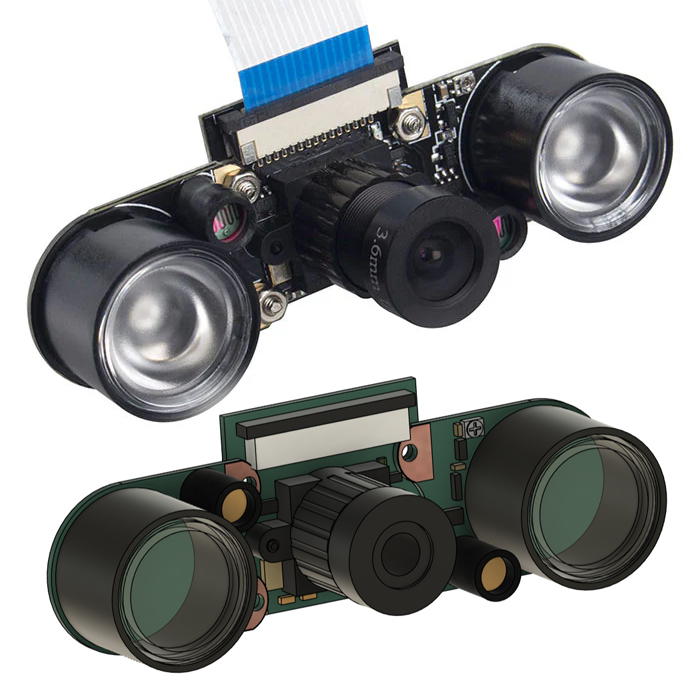
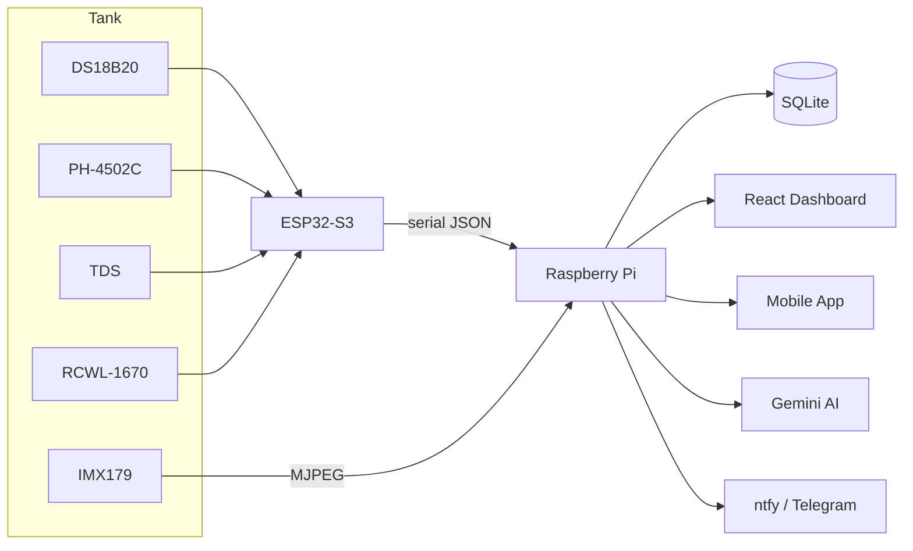

<script type="module" src="https://ajax.googleapis.com/ajax/libs/model-viewer/3.0.1/model-viewer.min.js"></script>

<p align="center">
  
</p>

<p align="center">
  <strong>Il cervello del tuo acquario. 🐟</strong><br>
  Monitoraggio in tempo reale: <strong>temp, pH, TDS, livello, camera, AI, notifiche</strong>.
</p>

<p align="center">
  <a href="#-italiano"><strong>🇮🇹 Italiano</strong></a> · <a href="#-english"><strong>🇬🇧 English</strong></a>
</p>

<p align="center">
  
  
  
  
  
</p>

<p align="center">
  <sub>
  <a href="#-caratteristiche">Caratteristiche</a> ·
  <a href="#-architettura">Architettura</a> ·
  <a href="#-struttura-della-repo">Contenuto</a> ·
  <a href="#-modelli-3d-interattivi">Modelli 3D</a> ·
  <a href="#-rendering-e-telecamera-subacquea">Rendering</a> ·
  <a href="#-quick-start">Quick start</a> ·
  <a href="#-api">API</a> ·
  <a href="#-componenti">Componenti</a>
  </sub>
</p>

---

# 🇮🇹 Italiano

## 🐟 Cos'è AquaMind

**AquaMind** è un sistema completo e open source per il monitoraggio e il controllo di un
acquario. Un microcontrollore raccoglie i dati dei sensori immersi, un Raspberry Pi fa da
cervello centrale (storico, video, AI e notifiche) e una dashboard web + app mobile ti
permettono di tenere d'occhio tutto, anche da lontano.

Il progetto copre **l'intera catena**: dal firmware del sensore, alla PCB custom, al
case stampato in 3D, fino al backend Docker e alla frontend React.

### ⚙️ Caratteristiche

| Area | Cosa fa |
|------|---------|
| 📷 **Video** | Telecamera **IMX179** (8MP, 1080p) in una **sfera trasparente da giardino riadattata**, streaming MJPEG live + versione night-vision |
| 💡 **Controllo** | Luci, pompa, skimmer, scaldabagno, feeder — da web e app |
| 📅 **Scheduler** | Programmazioni automatiche (on/off) per ogni dispositivo |
| 🤖 **AI** | Integrazione **Google Gemini** per diagnostica e controllo |
| 🔔 **Notifiche** | Allarmi su **ntfy** e **Telegram** quando un parametro esce dalle soglie |
| 📈 **Storico** | Dati archiviati con storico consultabile (API `/sensors/history`) |
| 📱 **UI** | Dashboard **React** + API REST per app mobile |
| 🧩 **Home Assistant** | Componente custom per le luci **Chihiros** (BLE) |

---

## 🧠 Architettura

Il flusso è semplice: l'**ESP32-S3** legge i sensori e li pubblica in JSON via seriale;
il **Raspberry Pi** (in Docker) li riceve e li archivia, fa da hub per video e controlli,
e spinge gli eventi verso la dashboard, l'app e i canali di notifica.



---

## 📦 Struttura della repo

La repo è organizzata in 4 aree, una per ogni "livello" del progetto:

```
.
├── 3D/
│   ├── case/            #    Scocca: base, coperchio, attacco sensori, spessore, tappo
│   ├── display/         #    display_aquamind + attacco vetro 53 mm (SLDPRT/STEP)
│   └── completo/        #    Assiemi principali in GLB (visibili nel browser)
├── codice/
│   ├── esp32-s3/        # Firmware sensore (ESP32-S3, v2.0.0-S3)
│   └── raspberry/       # Sistema completo dockerizzato (backend + frontend)
│       ├── backend/     #   Node.js: API, storico, video, AI, notifiche, Chihiros
│       ├── frontend/    #   React + Vite + Tailwind (dashboard)
│       ├── docs/        #   Note di setup (Bluetooth, ecc.)
│       └── docker-compose.yml
├── pcb/
│   └── kicad/           # Progetto KiCad: sch, pcb, gerber, BOM, netlist, positions
│       ├── gerber/      #   File di produzione (pronti per il fab)
│       └── production/  #   BOM, designatori, netlist IPC, positions
├── rendering/           # Rendering del sistema completo
└── docs/                # Immagini e banner della pagina
```

### 🧊 1 · Case e modelli 3D

La meccanica è progettata in **SolidWorks** (sorgenti `.SLDPRT`) ed esportata in
**STEP** (formato neutro per CAD/verifica). Nel repo trovi:

- **`3D/case/`** — la scocca completa: base, coperchio, attacco sensori, spessore,
  tappo e l'assieme (`AquaMind.step`).
- **`3D/display/`** — l'**alloggiamento del display** (`display_aquamind`) e
  l'**attacco vetro 53 mm**, il supporto che fissa la sfera della telecamera al
  vetro dell'acquario.
- **`3D/completo/`** — gli **assiemi principali in GLB**, visibili direttamente nel
  browser ([Modelli 3D interattivi](#-modelli-3d-interattivi)).

> 💡 I `.SLDPRT` sono i sorgenti SolidWorks, i `.STEP` il formato di scambio neutro.

### 🔲 2 · Firmware sensore (ESP32-S3)

`codice/esp32-s3/Aquamind-s3.ino` — firmware che legge i 4 sensori e li pubblica in JSON
via seriale/UART ogni 2 secondi, con **display OLED** locale e **calibrazione su EEPROM**
(pH offset, TDS coefficiente, range livello).

- **DS18B20** → temperatura (OneWire)
- **PH-4502C** → pH (ADC)
- **TDS** → salinità (ADC)
- **RCWL-1670** → livello acqua (onde millimetriche)
- **SSD1306** → display OLED 128×64 (I²C)

### 🍓 3 · Sistema Raspberry Pi (Docker)

`codice/raspberry/` è il sistema completo **dockerizzato** (backend + frontend in
container):

- **`backend/`** — server **Node.js**: API REST, ingest seriale, streaming video MJPEG,
  storico SQLite, controlli, scheduler, proxy **Gemini AI**, notifiche **ntfy/Telegram**
  e daemon per le luci **Chihiros** (BLE).
- **`frontend/`** — dashboard **React + Vite + Tailwind**, servita via **Nginx**.
- **`docker-compose.yml`** — orchestra i due servizi (backend in `host` network per
  USB/BLE, frontend sulla porta 80).

<details>
<summary><b>Avvio rapido</b></summary>

```bash
cd codice/raspberry
cp backend/.env.example backend/.env   # inserisci GEMINI_API_KEY, token, ecc.
docker-compose build
docker-compose up -d
# Dashboard: http://<ip-raspberry>/
```

</details>

### 🛠️ 4 · PCB (KiCad)

`pcb/kicad/` contiene il progetto **KiCad** completo della scheda AquaMind:

- `AquaMind.kicad_sch` / `AquaMind.kicad_pcb` — schematico e layout PCB (2 layer)
- `gerber/` — set di produzione completo (Cu, mask, silkscreen, paste, edge cuts, drill)
- `production/` — **BOM**, **designatori**, **netlist IPC** e **positions** per la
  produzione
- `AquaMind.step` — modello 3D della PCB

## 🎮 Modelli 3D interattivi

I tre assiemi principali sono esportati in **GLB** (glTF binario) e si
visualizzano **direttamente qui, nel browser**: trascina per ruotare, usa la
rotella per lo zoom.

### 🔲 Assieme scheda + sensori

<model-viewer src="3D/completo/Assieme_scheda_e_sensori.glb" alt="Assieme AquaMind: PCB con sensori montati" shadow-intensity="0.5" auto-rotate auto-play style="width:100%;height:480px"></model-viewer>

### 📷 Assieme telecamera

 <model-viewer src="3D/completo/Assieme_telecamera.glb" alt="Assieme telecamera acquario" shadow-intensity="0.5" auto-rotate auto-play camera-orbit="0deg 80deg 100%" style="width:100%;height:480px"></model-viewer>

### 🛠️ PCB AquaMind

<model-viewer src="3D/completo/scheda.glb" alt="PCB AquaMind" shadow-intensity="0.5" auto-rotate auto-play style="width:100%;height:480px"></model-viewer>

---

## 🎨 Rendering e telecamera subacquea

Rendering del sistema completo:





### 📷 La sfera subacquea

Per alloggiare la telecamera in acqua è stata acquistata una **sfera trasparente da
giardino** — una di quelle con i LED a pannello solare che si usano per l'illuminazione
del verde — e **riadattata** apposta per questo scopo: al suo interno trova posto la
camera **IMX179** (8 MP, 1080p, CMOS 1/3.2″) e la sfera viene fissata al vetro
dell'acquario con l'**attacco 53 mm** (sorgenti in `3D/display/`).



---

## 🚀 Quick start

```bash
# 1. Clona la repo
git clone https://github.com/<tu-username>/AquaMind.git
cd AquaMind

# 2. Avvia il sistema Raspberry (Docker)
cd codice/raspberry
cp backend/.env.example backend/.env
docker-compose build && docker-compose up -d

# 3. Carica il firmware ESP32-S3 (da Arduino IDE)
#    Board: ESP32S3 Dev Module · Porta: /dev/ttyUSB*
```

Apri la dashboard su `http://<ip-raspberry>` e sei operativo. 🐠

---

## 🔌 API

| Endpoint | Metodo | Descrizione |
|----------|--------|------------|
| `/api/sensors` | GET | Dati sensori attuali |
| `/api/sensors/history?hours=24` | GET | Storico dati |
| `/api/controls` | GET / POST | Stato / controllo dispositivi |
| `/api/schedules` | GET / POST | Programmazioni |
| `/api/schedules/:id` | PUT / DELETE | Modifica / elimina programmazione |
| `/api/stream` | GET | Stream video MJPEG |
| `/api/status` | GET | Stato del sistema |
| `/api/gemini` | POST | Proxy Gemini AI |

Esempio:

```bash
curl http://raspberry/api/sensors
# {"temp":25.4,"ph":8.2,"tds":120,"level":98,"fw_version":"2.0.0-S3"}

curl -X POST http://raspberry/api/controls \
  -H "Content-Type: application/json" \
  -d '{"device":"mainLight","state":true}'
```

---

## 🖼️ Componenti

I componenti hardware al centro del progetto:

| | | |
|:---:|:---:|:---:|
|  |  |  |
| 🎥 **IMX179** — telecamera 8MP<br>night-vision in sfera subacquea | 🧪 **TDS** — sonda di salinità<br>ADC, calibrazione su EEPROM | 🔬 **PH-4502C** — sonda di pH<br>ADC, offset su EEPROM |
| |  |  |
| 🌡️ **DS18B20** — sonda di temperatura<br>bus OneWire | 📶 **RCWL-1670** — onde millimetriche<br>rilevamento livello acqua | 🖥️ **OLED SSD1306** — display locale<br>128×64 I²C |
|  |  | |
| 🧠 **ESP32-S3** — microcontrollore<br>lettura sensori + OLED | 🍓 **Raspberry Pi** — hub centrale<br>API, storico, video, AI | |

---

## 📄 Licenza

[MIT](LICENSE) — fai pure, contribuisci pure. 🐟
---

# 🇬🇧 English

## 🐟 What is AquaMind

**AquaMind** is a complete, open-source system for monitoring and controlling a
fish tank. A microcontroller reads the submerged sensors, a Raspberry Pi acts as the
central brain (history, video, AI and notifications) and a web dashboard + mobile app
let you keep an eye on everything, even from afar.

The project covers **the entire chain**: from the sensor firmware, to the custom PCB,
to the 3D-printed case, all the way to the Docker backend and the React frontend.

### ⚙️ Features

| Area | What it does |
|------|-------------|
| 📷 **Video** | **IMX179** camera (8MP, 1080p) inside a **repurposed transparent garden sphere**, live MJPEG streaming + night-vision mode |
| 💡 **Controls** | Lights, pump, skimmer, heater, feeder — from web and app |
| 📅 **Scheduler** | Automatic on/off schedules for every device |
| 🤖 **AI** | **Google Gemini** integration for diagnostics and control |
| 🔔 **Notifications** | **ntfy** and **Telegram** alerts when a parameter goes out of range |
| 📈 **History** | Archived data with browsable history (`/sensors/history` API) |
| 📱 **UI** | **React** dashboard + REST API for the mobile app |
| 🧩 **Home Assistant** | Custom component for **Chihiros** lights (BLE) |

---

## 🧠 Architecture

The flow is simple: the **ESP32-S3** reads the sensors and publishes them as JSON over
serial; the **Raspberry Pi** (in Docker) receives and stores them, acts as the hub for
video and controls, and pushes events to the dashboard, the app and the notification
channels.



---

## 📦 Repository structure

The repo is organized in 4 areas, one per "layer" of the project:

```
.
├── 3D/
│   ├── case/            #    Enclosure: base, lid, sensor mounts, spacer, cap
│   ├── display/         #    display_aquamind + 53 mm glass mount (SLDPRT/STEP)
│   └── completo/        #    Main assemblies as GLB (viewable in the browser)
├── codice/
│   ├── esp32-s3/        # Sensor firmware (ESP32-S3, v2.0.0-S3)
│   └── raspberry/       # Full dockerized system (backend + frontend)
│       ├── backend/     #   Node.js: API, history, video, AI, notifications, Chihiros
│       ├── frontend/    #   React + Vite + Tailwind (dashboard)
│       ├── docs/        #   Setup notes (Bluetooth, etc.)
│       └── docker-compose.yml
├── pcb/
│   └── kicad/           # KiCad project: sch, pcb, gerber, BOM, netlist, positions
│       ├── gerber/      #   Production files (fab-ready)
│       └── production/  #   BOM, designators, IPC netlist, positions
├── rendering/           # Full-system renderings
└── docs/                # Page images and banner
```

### 🧊 1 · Case and 3D models

The mechanics are designed in **SolidWorks** (`.SLDPRT` sources) and exported as
**STEP** (neutral format for CAD/verification). In the repo you will find:

- **`3D/case/`** — the complete enclosure: base, lid, sensor mounts, spacer, cap and
  the full assembly (`AquaMind.step`).
- **`3D/display/`** — the **display housing** (`display_aquamind`) and the **53 mm
  glass mount**, the bracket that fixes the camera sphere to the tank glass.
- **`3D/completo/`** — the **main assemblies as GLB**, viewable directly in the
  browser ([Interactive 3D models](#-interactive-3d-models)).

> 💡 `.SLDPRT` are the SolidWorks sources, `.STEP` is the neutral exchange format.

### 🔲 2 · Sensor firmware (ESP32-S3)

`codice/esp32-s3/Aquamind-s3.ino` — firmware that reads the 4 sensors and publishes
them as JSON over serial/UART every 2 seconds, with a **local OLED display** and
**EEPROM-based calibration** (pH offset, TDS coefficient, level range).

- **DS18B20** → temperature (OneWire)
- **PH-4502C** → pH (ADC)
- **TDS** → salinity (ADC)
- **RCWL-1670** → water level (mmWave)
- **SSD1306** → 128×64 OLED display (I²C)

### 🍓 3 · Raspberry Pi system (Docker)

`codice/raspberry/` is the complete **dockerized** system (backend + frontend in
containers):

- **`backend/`** — **Node.js** server: REST API, serial ingest, MJPEG video streaming,
  SQLite history, controls, scheduler, **Gemini AI** proxy, **ntfy/Telegram**
  notifications and a daemon for the **Chihiros** lights (BLE).
- **`frontend/`** — **React + Vite + Tailwind** dashboard, served by **Nginx**.
- **`docker-compose.yml`** — orchestrates the two services (backend on `host`
  network for USB/BLE, frontend on port 80).

<details>
<summary><b>Quick start</b></summary>

```bash
cd codice/raspberry
cp backend/.env.example backend/.env   # add GEMINI_API_KEY, tokens, etc.
docker-compose build
docker-compose up -d
# Dashboard: http://<raspberry-ip>/
```

</details>

### 🛠️ 4 · PCB (KiCad)

`pcb/kicad/` contains the complete **KiCad** project of the AquaMind board:

- `AquaMind.kicad_sch` / `AquaMind.kicad_pcb` — schematic and PCB layout (2 layers)
- `gerber/` — complete production set (Cu, mask, silkscreen, paste, edge cuts, drill)
- `production/` — **BOM**, **designators**, **IPC netlist** and **positions** for
  manufacturing
- `AquaMind.step` — 3D model of the PCB

## 🎮 Interactive 3D models

The three main assemblies are exported as **GLB** (binary glTF) and render
**right here, in the browser**: drag to rotate, scroll to zoom.

### 🔲 Board + sensors assembly

<model-viewer src="3D/completo/Assieme_scheda_e_sensori.glb" alt="AquaMind assembly: PCB with mounted sensors" shadow-intensity="0.5" auto-rotate auto-play style="width:100%;height:480px"></model-viewer>

### 📷 Camera assembly

 <model-viewer src="3D/completo/Assieme_telecamera.glb" alt="Aquarium camera assembly" shadow-intensity="0.5" auto-rotate auto-play camera-orbit="0deg 80deg 100%" style="width:100%;height:480px"></model-viewer>

### 🛠️ AquaMind PCB

<model-viewer src="3D/completo/scheda.glb" alt="AquaMind PCB" shadow-intensity="0.5" auto-rotate auto-play style="width:100%;height:480px"></model-viewer>

---

## 🎨 Renderings and underwater camera

Full-system renderings:


### 📷 The underwater sphere

To house the camera underwater, a **transparent garden sphere** was purchased — one of
those solar-panel LED globes used for garden lighting — and **repurposed** for this
purpose: inside it sits the **IMX179** camera (8 MP, 1080p, 1/3.2″ CMOS), and the
sphere is fixed to the tank glass with the **53 mm mount** (sources in `3D/display/`).


---

## 🚀 Quick start

```bash
# 1. Clone the repo
git clone https://github.com/<your-username>/AquaMind.git
cd AquaMind

# 2. Start the Raspberry system (Docker)
cd codice/raspberry
cp backend/.env.example backend/.env
docker-compose build && docker-compose up -d

# 3. Flash the ESP32-S3 firmware (from Arduino IDE)
#    Board: ESP32S3 Dev Module · Port: /dev/ttyUSB*
```

Open the dashboard at `http://<raspberry-ip>` and you are up and running. 🐠

---

## 🔌 API

| Endpoint | Method | Description |
|----------|--------|-------------|
| `/api/sensors` | GET | Current sensor data |
| `/api/sensors/history?hours=24` | GET | Data history |
| `/api/controls` | GET / POST | Device state / control |
| `/api/schedules` | GET / POST | Schedules |
| `/api/schedules/:id` | PUT / DELETE | Update / delete schedule |
| `/api/stream` | GET | MJPEG video stream |
| `/api/status` | GET | System status |
| `/api/gemini` | POST | Gemini AI proxy |

Example:

```bash
curl http://raspberry/api/sensors
# {"temp":25.4,"ph":8.2,"tds":120,"level":98,"fw_version":"2.0.0-S3"}

curl -X POST http://raspberry/api/controls \
  -H "Content-Type: application/json" \
  -d '{"device":"mainLight","state":true}'
```

---

## 🖼️ Components

The hardware components at the heart of the project:

| | | |
|:---:|:---:|:---:|
|  |  |  |
| 🎥 **IMX179** — 8MP camera<br>night-vision in the underwater sphere | 🧪 **TDS** — salinity probe<br>ADC, EEPROM calibration | 🔬 **PH-4502C** — pH probe<br>ADC, EEPROM offset |
 |  |  |  |
| 🌡️ **DS18B20** — temperature probe<br>OneWire bus | 📶 **RCWL-1670** — mmWave module<br>water-level detection | 🖥️ **OLED SSD1306** — local display<br>128×64 I²C |
|  |  | |
| 🧠 **ESP32-S3** — microcontroller<br>sensor reading + OLED | 🍓 **Raspberry Pi** — central hub<br>API, history, video, AI | |

---

## 📄 License

[MIT](LICENSE) — fork it, improve it, share it. 🐟
