<script type="module" src="https://ajax.googleapis.com/ajax/libs/model-viewer/3.0.1/model-viewer.min.js"></script>

<p align="center">
  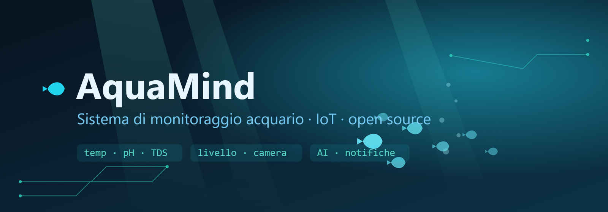
</p>

<p align="center">
  <strong>Il cervello del tuo acquario. 🐟</strong><br>
  Monitoraggio in tempo reale: <strong>temp, pH, TDS, livello, camera, AI, notifiche</strong>.
</p>

<p align="center">
  <strong>🇮🇹 Italiano</strong> · <a href="README.md"><strong>🇬🇧 English</strong></a>
</p>

<p align="center">
  
  
  
  
  
  <a href="https://pcbway.com"></a>
</p>

<p align="center">
  <sub>
  <a href="#-caratteristiche">Caratteristiche</a> ·
  <a href="#-dashboard-web">Dashboard</a> ·
  <a href="#-architettura">Architettura</a> ·
  <a href="#-struttura-della-repo">Contenuto</a> ·
  <a href="#-modelli-3d-interattivi">Modelli 3D</a> ·
  <a href="#-rendering-e-telecamera-subacquea">Rendering</a> ·
  <a href="#-quick-start">Quick start</a> ·
  <a href="#-api">API</a> ·
  <a href="#-componenti">Componenti</a> ·
  <a href="#-sponsor--pcbway">Sponsor · PCBWay</a>
  </sub>
</p>

---

# 🇮🇹 AquaMind


## 🐟 Cos'è AquaMind

**AquaMind** è un sistema completo e open source per il monitoraggio e il controllo di un
acquario. Un microcontrollore raccoglie i dati dei sensori immersi, un Raspberry Pi fa da
cervello centrale (storico, video, AI e notifiche) e una dashboard web + app mobile ti
permettono di tenere d'occhio tutto, anche da lontano.

Il progetto copre **l'intera catena**: dal firmware del sensore, alla PCB custom, al
case stampato in 3D, fino al backend Docker e alla frontend React.

### 📸 Il prototipo finale

Un tour fotografico del prototipo realizzato: PCB custom, scocca stampata in 3D e tutti i componenti. **Clicca una foto per aprirla a dimensione completa.**

<table>
  <tr>
    <td align="center"><a href="images/proto_01.jpg">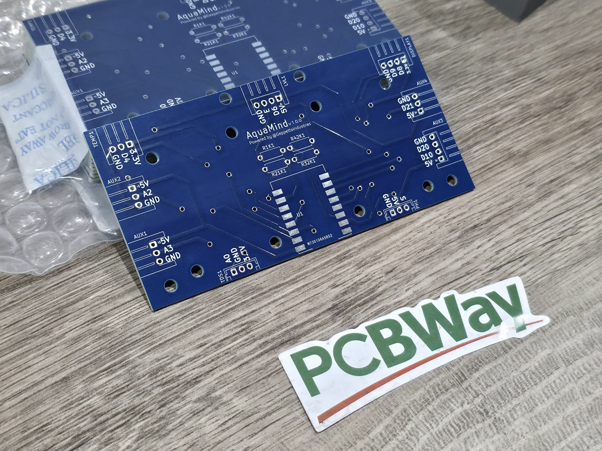</a><br><sub>🏭 PCB realizzato da PCBWay</sub></td>
    <td align="center"><a href="images/proto_02.jpg">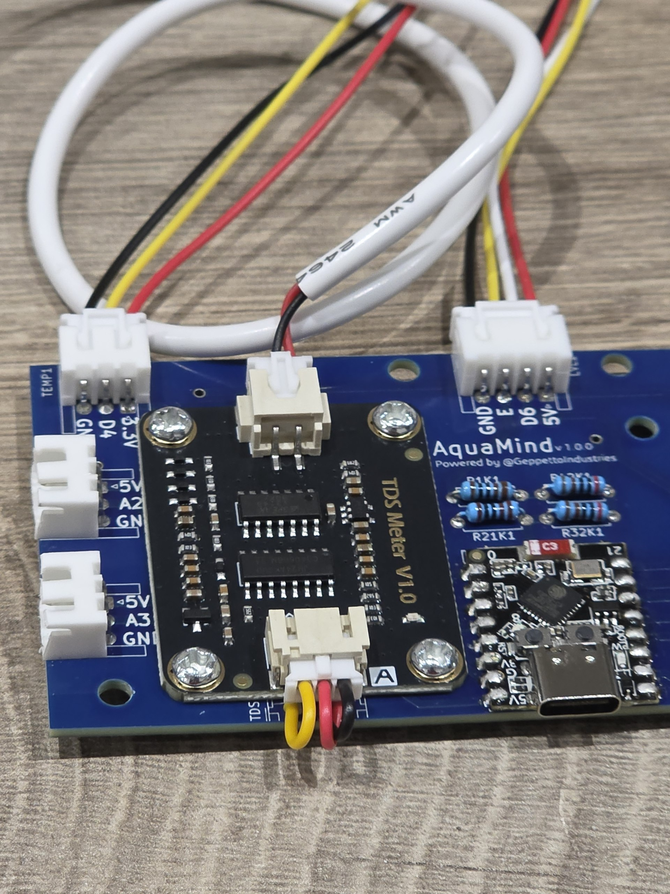</a><br><sub>🧩 Componenti &amp; connettori JST</sub></td>
    <td align="center"><a href="images/proto_03.jpg">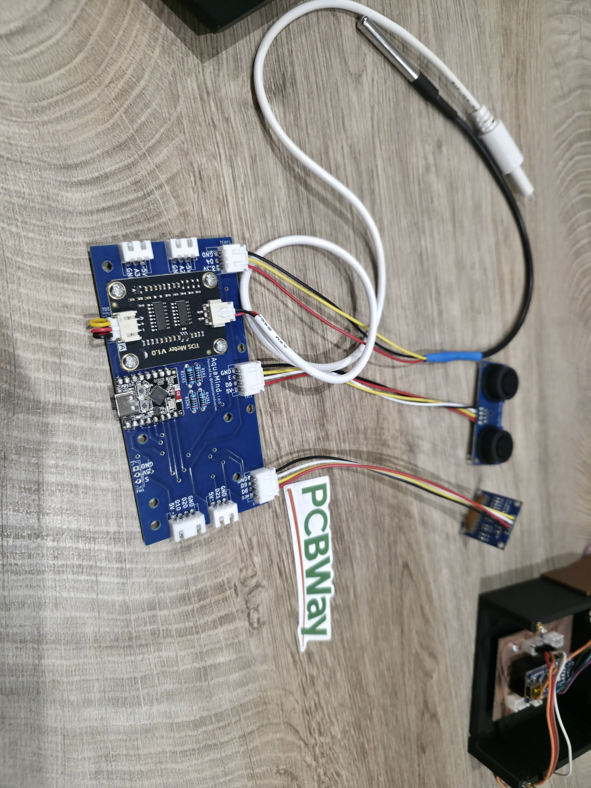</a><br><sub>🔌 Sensori cablati + ESP32</sub></td>
  </tr>
  <tr>
    <td align="center"><a href="images/proto_04.jpg">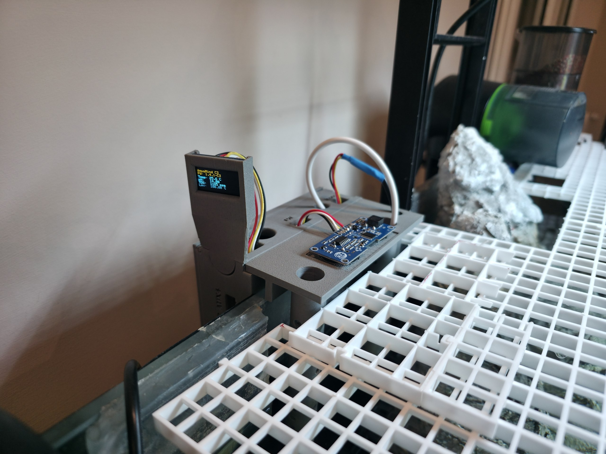</a><br><sub>🧊 Scocca stampata in 3D + PCB</sub></td>
    <td align="center"><a href="images/proto_05.jpg">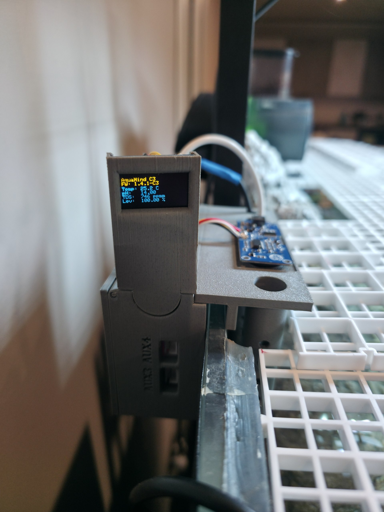</a><br><sub>🖥️ Scocca con display OLED</sub></td>
    <td align="center"><a href="images/proto_06.jpg">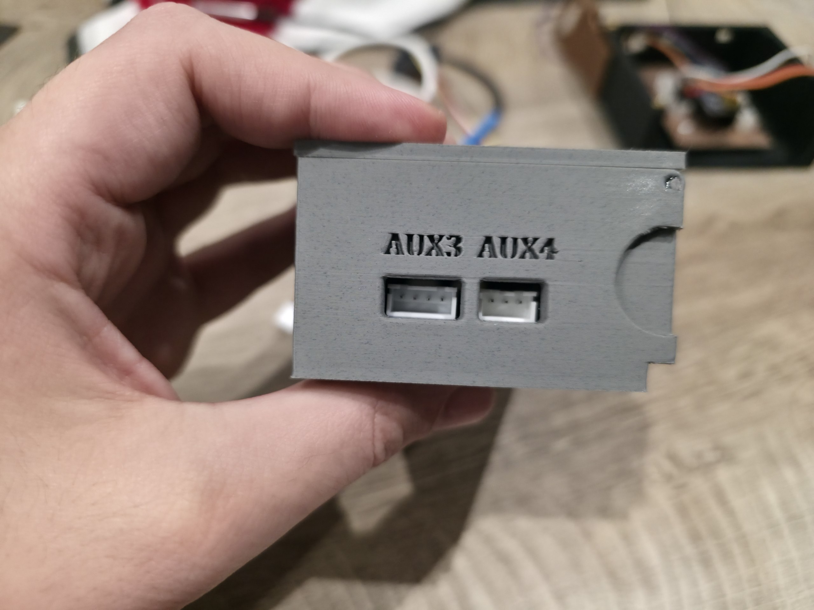</a><br><sub>🐟 Coperchio stampato in 3D "AQUAMIND"</sub></td>
  </tr>
  <tr>
    <td align="center"><a href="images/proto_07.jpg">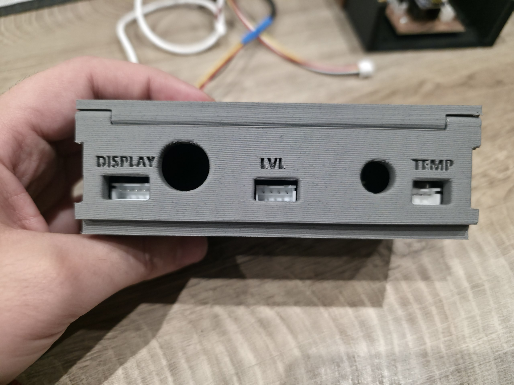</a><br><sub>🏷️ Pannello frontale · TEMP · PH · TDS · LEVEL</sub></td>
    <td align="center"><a href="images/proto_08.jpg">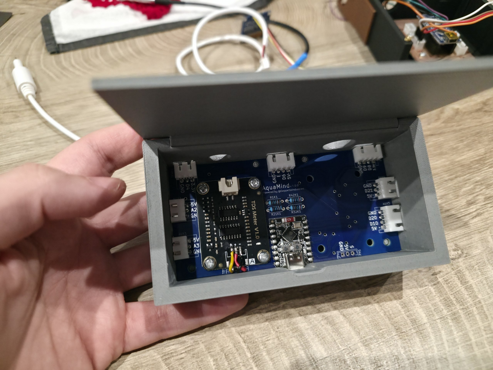</a><br><sub>📂 Scocca aperta, PCB dentro</sub></td>
    <td align="center"><a href="images/proto_09.jpg">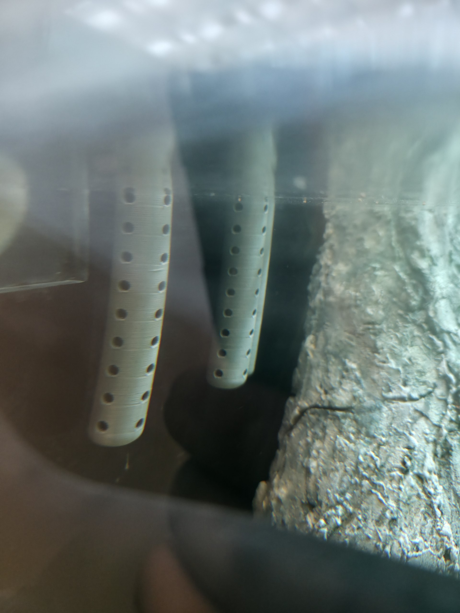</a><br><sub>🐠 Il prototipo in acquario</sub></td>
  </tr>
</table>

### ⚙️ Caratteristiche

| Area | Cosa fa |
|------|---------|
| 📷 **Video** | Telecamera **IMX179** (8MP, 1080p) in una **sfera trasparente da giardino riadattata**, streaming MJPEG live + versione night-vision |
| 💡 **Controllo** | Luci, pompa, skimmer, scaldabagno, feeder — da web e app |
| 📅 **Scheduler** | Programmazioni automatiche (on/off) per ogni dispositivo |
| 🤖 **AI** | Integrazione **Google Gemini** per diagnostica e controllo |
| 🔔 **Notifiche** | Allarmi su **ntfy** e **Telegram** quando un parametro esce dalle soglie |
| 📈 **Storico** | Dati archiviati con storico consultabile (API `/sensors/history`) |
| 📱 **UI** | Dashboard **React** + API REST per app mobile |
| 🧩 **Home Assistant** | Componente custom per le luci **Chihiros** (BLE) |

---

## 🖥️ Dashboard web

La dashboard React è il centro di controllo: video live dalla sfera subacquea,
card sensori in tempo reale, agente AI, controlli manuali, programmazioni,
calendario manutenzione, inventario pesci e storico completo. **Clicca uno
screen per aprirlo a dimensione completa.**

<table>
  <tr>
    <td align="center"><a href="images/ui_01_dashboard.png">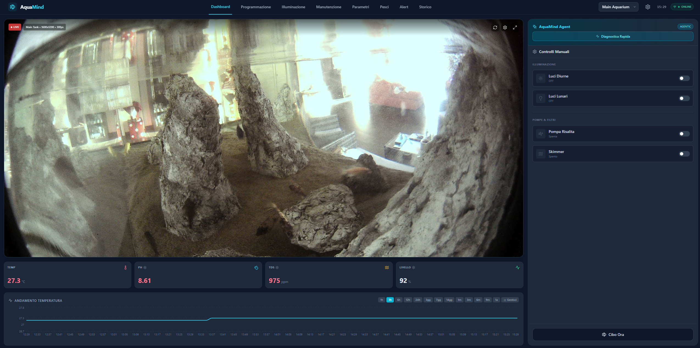</a><br><sub>📷 <b>Dashboard</b> — video live, sensori (TEMP · PH · TDS · LEVEL), agente AI AquaMind, controlli manuali</sub></td>
  </tr>
  <tr>
    <td align="center"><a href="images/ui_02_maintenance.png">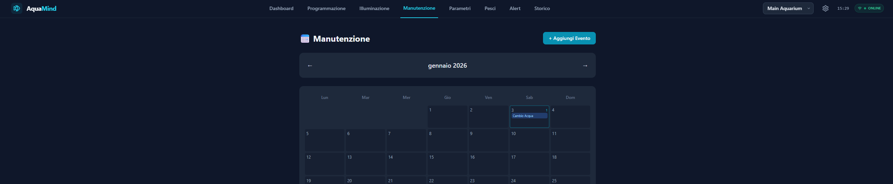</a><br><sub>📅 <b>Manutenzione</b> — calendario con cambi d'acqua e interventi programmati</sub></td>
    <td align="center"><a href="images/ui_03_water_params.png">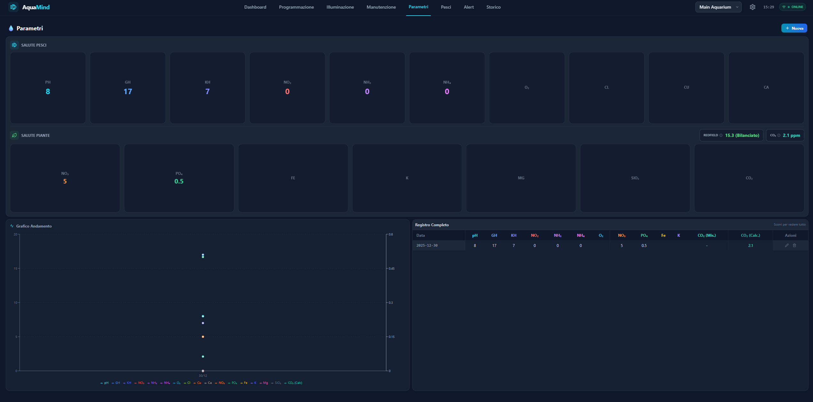</a><br><sub>💧 <b>Parametri acqua</b> — analisi completa, durezza, ricetta</sub></td>
  </tr>
  <tr>
    <td align="center"><a href="images/ui_04_fish.png">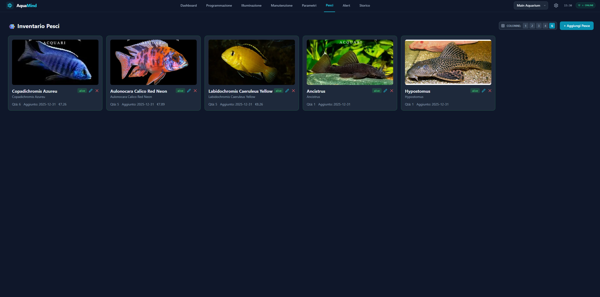</a><br><sub>🐠 <b>Inventario pesci</b> — specie, quantità, cibo e ultimo pasto</sub></td>
    <td align="center"><a href="images/ui_05_history.png">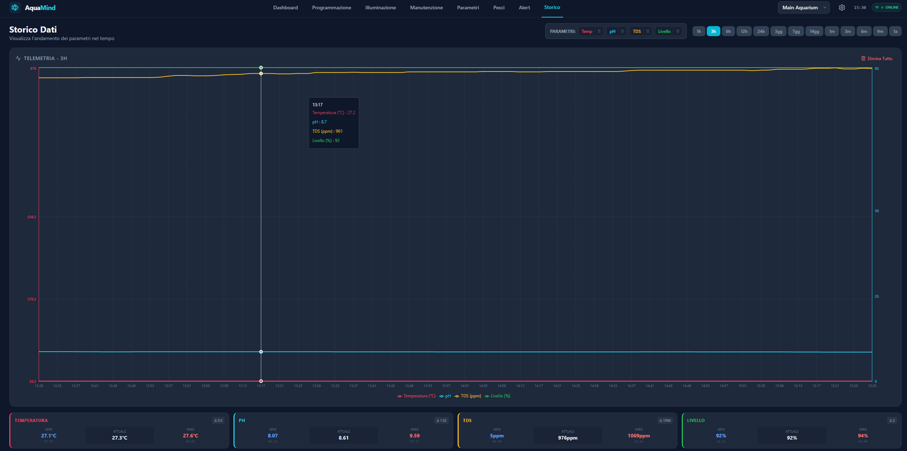</a><br><sub>📈 <b>Storico</b> — grafici telemetria con statistiche min/max/medie</sub></td>
  </tr>
</table>

---

## 🧠 Architettura

Il flusso è semplice: l'**ESP32-S3** legge i sensori e li pubblica in JSON via seriale;
il **Raspberry Pi** (in Docker) li riceve e li archivia, fa da hub per video e controlli,
e spinge gli eventi verso la dashboard, l'app e i canali di notifica.

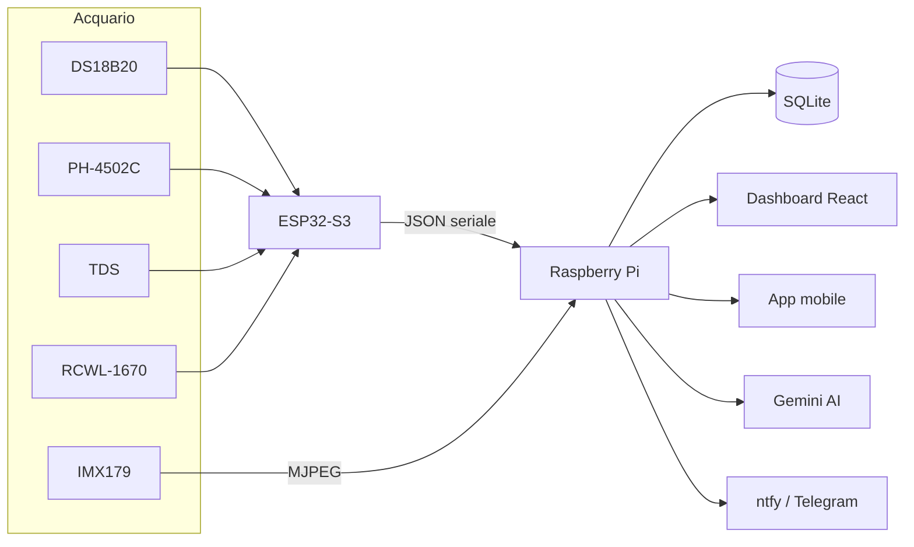

---

## 📦 Struttura della repo

La repo è organizzata in 4 aree, una per ogni "livello" del progetto:

```
.
├── 3D/
│   ├── case/            #    Scocca: base, coperchio, attacco sensori, spessore, tappo
│   ├── display/         #    display_aquamind + attacco vetro 53 mm (SLDPRT/STEP)
│   └── completo/        #    Assiemi principali in GLB (visibili nel browser)
├── codice/
│   ├── esp32-s3/        # Firmware sensore (ESP32-S3, v2.0.0-S3)
│   └── raspberry/       # Sistema completo dockerizzato (backend + frontend)
│       ├── backend/     #   Node.js: API, storico, video, AI, notifiche, Chihiros
│       ├── frontend/    #   React + Vite + Tailwind (dashboard)
│       ├── docs/        #   Note di setup (Bluetooth, ecc.)
│       └── docker-compose.yml
├── pcb/
│   └── kicad/           # Progetto KiCad: sch, pcb, gerber, BOM, netlist, positions
│       ├── gerber/      #   File di produzione (pronti per il fab)
│       └── production/  #   BOM, designatori, netlist IPC, positions
├── rendering/           # Rendering del sistema completo
├── images/              # Foto del prototipo + screen della dashboard
└── docs/                # Immagini e banner della pagina
```

### 🧊 1 · Case e modelli 3D

La meccanica è progettata in **SolidWorks** (sorgenti `.SLDPRT`) ed esportata in
**STEP** (formato neutro per CAD/verifica). Nel repo trovi:

- **`3D/case/`** — la scocca completa: base, coperchio, attacco sensori, spessore,
  tappo e l'assieme (`AquaMind.step`).
- **`3D/display/`** — l'**alloggiamento del display** (`display_aquamind`) e
  l'**attacco vetro 53 mm**, il supporto che fissa la sfera della telecamera al
  vetro dell'acquario.
- **`3D/completo/`** — gli **assiemi principali in GLB**, visibili direttamente nel
  browser ([Modelli 3D interattivi](#-modelli-3d-interattivi)).

> 💡 I `.SLDPRT` sono i sorgenti SolidWorks, i `.STEP` il formato di scambio neutro.

### 🔲 2 · Firmware sensore (ESP32-S3)

`codice/esp32-s3/Aquamind-s3.ino` — firmware che legge i 4 sensori e li pubblica in JSON
via seriale/UART ogni 2 secondi, con **display OLED** locale e **calibrazione su EEPROM**
(pH offset, TDS coefficiente, range livello).

- **DS18B20** → temperatura (OneWire)
- **PH-4502C** → pH (ADC)
- **TDS** → salinità (ADC)
- **RCWL-1670** → livello acqua (onde millimetriche)
- **SSD1306** → display OLED 128×64 (I²C)

### 🍓 3 · Sistema Raspberry Pi (Docker)

`codice/raspberry/` è il sistema completo **dockerizzato** (backend + frontend in
container):

- **`backend/`** — server **Node.js**: API REST, ingest seriale, streaming video MJPEG,
  storico SQLite, controlli, scheduler, proxy **Gemini AI**, notifiche **ntfy/Telegram**
  e daemon per le luci **Chihiros** (BLE).
- **`frontend/`** — dashboard **React + Vite + Tailwind**, servita via **Nginx**.
- **`docker-compose.yml`** — orchestra i due servizi (backend in `host` network per
  USB/BLE, frontend sulla porta 80).
#### Cosa fa il backend (sottosistemi)

| Sottosistema | Come funziona |
|----------------|---------------|
| **REST API** | Express (`server.js`) espone gli endpoint `/api/*` per dashboard e app mobile |
| **WebSocket** | `ws` su `/ws` → push live di sensori, stati e alert verso la dashboard |
| **Ingest seriale** | `serialport` legge i JSON dall'ESP32; una porta seriali per acquario (`tankSerialPorts`) |
| **Storico** | `better-sqlite3` con tabelle `sensors`, `alert_log`, `schedules`, `chihiros_devices`, `maintenance_log`, `water_parameters`, `fish_inventory` (+ migrazioni automatiche) |
| **Video** | `child_process` + `ffmpeg` → stream MJPEG da `/dev/video0` (`/api/stream`) |
| **Scheduler** | On/off automatici per dispositivo, con active-devices (`/api/schedules/active-devices`) |
| **Alert** | Soglie e delta configurabili, log eventi, test notifica (`/api/alerts/*`) |
| **Notifiche** | Push su **ntfy** e **Telegram** quando un parametro esce dalle soglie |
| **Chihiros BLE** | Daemon Python (`chihiros_daemon.py` + `bleak`) gestisce scan, on/off, luminosità, RGB, canali, schedule e auto-mode delle lampade |
| **AI** | Proxy **Gemini** (`/api/gemini`) con conversazioni e ricette salvate |
| **Multi-acquario** | CRUD acquari, calibrazione remota, impostazioni camera, export/import config |
| **Firmware** | Flash del firmware ESP32 via upload seriale (`/api/tanks/:id/firmware`) |
| **Backup** | Export/import del database (`/api/backup`, `/api/restore`) |

<details>
<summary><b>Avvio rapido</b></summary>

```bash
cd codice/raspberry
cp backend/.env.example backend/.env   # inserisci GEMINI_API_KEY, token, ecc.
docker-compose build
docker-compose up -d
# Dashboard: http://<ip-raspberry>/
```

</details>

### 🛠️ 4 · PCB (KiCad)

`pcb/kicad/` contiene il progetto **KiCad** completo della scheda AquaMind:

- `AquaMind.kicad_sch` / `AquaMind.kicad_pcb` — schematico e layout PCB (2 layer)
- `gerber/` — set di produzione completo (Cu, mask, silkscreen, paste, edge cuts, drill)
- `production/` — **BOM**, **designatori**, **netlist IPC** e **positions** per la
 produzione
- `AquaMind.step` — modello 3D della PCB

> ℹ️ Nella BOM la scheda usa il modulo **ESP32-C3 SuperMini** (`U1`); il firmware
> in `codice/esp32-s3/Aquamind-s3.ino` è scritto per **ESP32-S3 DevKit** — i pin
> sono configurabili in testa al file.

> 🏭 **Le PCB di questo progetto sono realizzate da [PCBWay](https://pcbway.com)** —
> i file in `gerber/` e `production/` sono pronti per il loro ordine di produzione.

## 🏭 Sponsor · PCBWay

<p align="center">
  <a href="https://pcbway.com"></a>
</p>

Un ringraziamento speciale a **[PCBWay](https://pcbway.com)**, **sponsor ufficiale del
progetto per la realizzazione delle PCB**: hanno prodotto la scheda AquaMind
(e i prototipi delle revisioni) partendo direttamente dai Gerber e dalla BOM
presenti in `pcb/kicad/`.

Grazie al loro supporto il progetto ha potuto iterare rapidamente sul layout,
provare i footprints reali dei connettori JST e validare la scheda finale.

- 📂 Gerber pronti: `pcb/kicad/gerber/`
- 📋 BOM + positions + netlist IPC: `pcb/kicad/production/`
- 🧊 Modello 3D della scheda: `pcb/kicad/AquaMind.step`

Se vuoi costruire la scheda, carica il set Gerber su PCBWay; il progetto
ringrazia chi contribuisce alla filiera hardware. 🐟

---
## 🎮 Modelli 3D interattivi

I tre assiemi principali sono esportati in **GLB** (glTF binario) e si
visualizzano **direttamente qui, nel browser**: trascina per ruotare, usa la
rotella per lo zoom.

### 🔲 Assieme scheda + sensori

<model-viewer src="3D/completo/Assieme_scheda_e_sensori.glb" alt="Assieme AquaMind: PCB con sensori montati" poster="images/proto_03.jpg" auto-rotate camera-controls shadow-intensity="0.5" style="width:100%;height:480px"></model-viewer>

### 📷 Assieme telecamera

<model-viewer src="3D/completo/Assieme_telecamera.glb" alt="Assieme telecamera acquario" poster="docs/imx179-camera.jpg" auto-rotate camera-controls shadow-intensity="0.5" style="width:100%;height:480px"></model-viewer>

### 🛠️ PCB AquaMind

<model-viewer src="3D/completo/scheda.glb" alt="PCB AquaMind" poster="images/proto_02.jpg" auto-rotate camera-controls shadow-intensity="0.5" style="width:100%;height:480px"></model-viewer>

---

## 🎨 Rendering e telecamera subacquea

Screen dei modelli 3D (dagli assiemi GLB qui sopra):

<table>
  <tr>
    <td align="center"><a href="docs/model_board.png">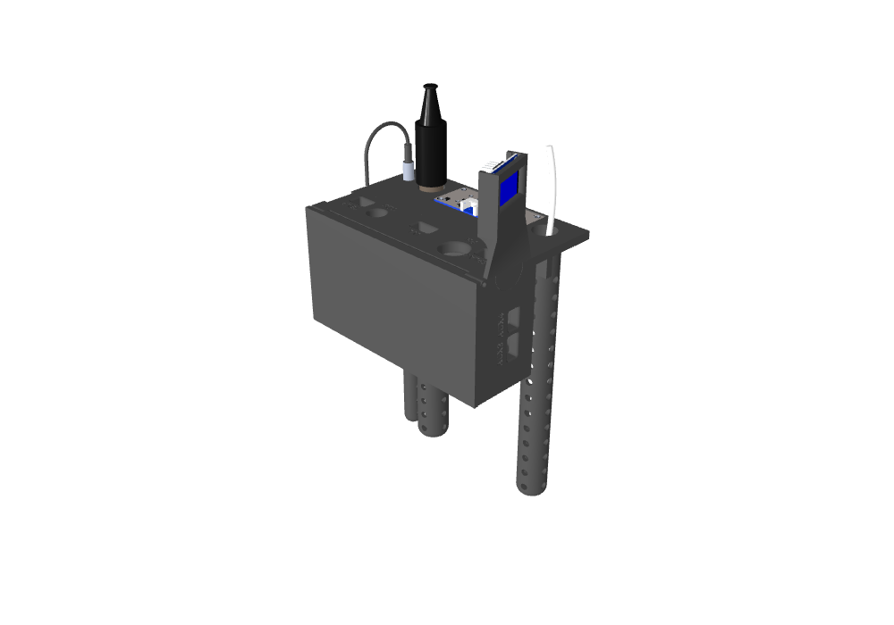</a><br><sub>🧊 Assieme scheda + sensori</sub></td>
    <td align="center"><a href="docs/model_camera.png">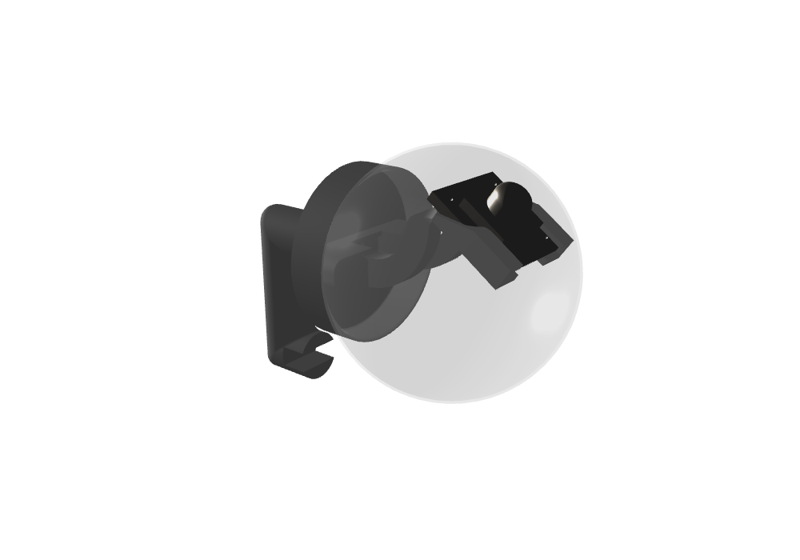</a><br><sub>📷 Sfera telecamera + attacco 53 mm</sub></td>
    <td align="center"><a href="docs/model_pcb.png">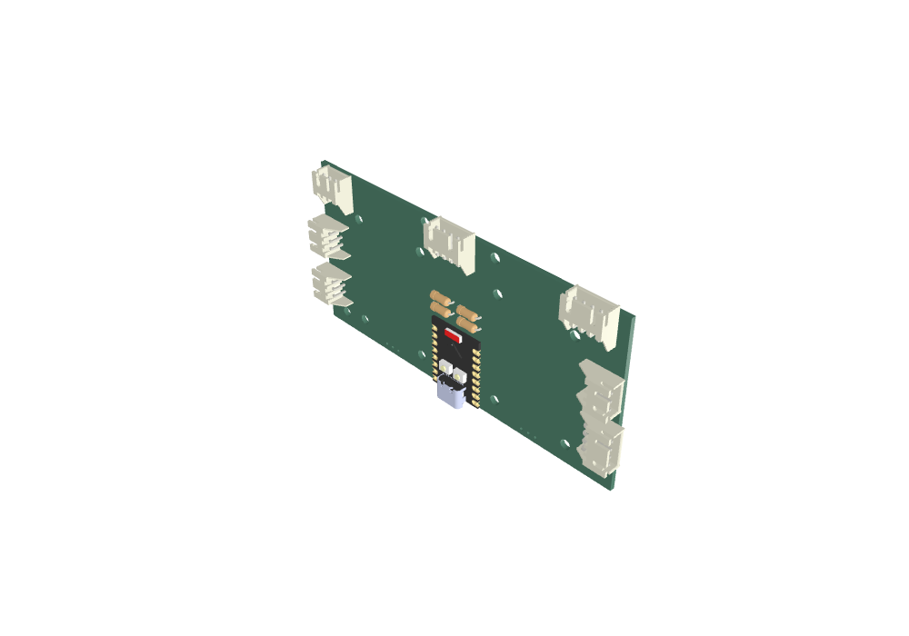</a><br><sub>🛠️ PCB AquaMind</sub></td>
  </tr>
</table>

### 📷 La sfera subacquea

Per alloggiare la telecamera in acqua è stata acquistata una **sfera trasparente da
giardino** — una di quelle con i LED a pannello solare che si usano per l'illuminazione
del verde — e **riadattata** apposta per questo scopo: al suo interno trova posto la
camera **IMX179** (8 MP, 1080p, CMOS 1/3.2″) e la sfera viene fissata al vetro
dell'acquario con l'**attacco 53 mm** (sorgenti in `3D/display/`).

<p align="center">
  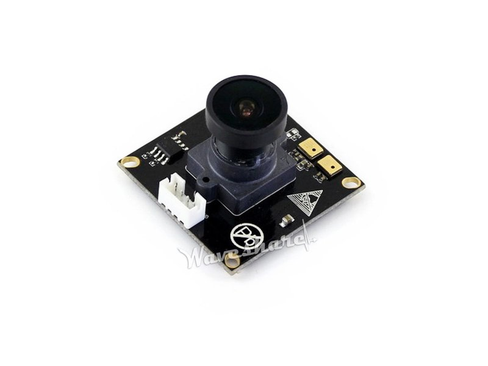
</p>

---

## 🚀 Quick start

```bash
# 1. Clona la repo
git clone https://github.com/<tu-username>/AquaMind.git
cd AquaMind

# 2. Avvia il sistema Raspberry (Docker)
cd codice/raspberry
cp backend/.env.example backend/.env
docker-compose build && docker-compose up -d

# 3. Carica il firmware ESP32-S3 (da Arduino IDE)
#    Board: ESP32S3 Dev Module · Porta: /dev/ttyUSB*
```

Apri la dashboard su `http://<ip-raspberry>` e sei operativo. 🐠

---

## 🔌 API

| Endpoint | Metodo | Descrizione |
|----------|--------|------------|
| `/api/sensors` | GET | Dati sensori attuali |
| `/api/sensors/history?hours=24` | GET | Storico dati |
| `/api/controls` | GET / POST | Stato / controllo dispositivi |
| `/api/schedules` | GET / POST | Programmazioni |
| `/api/schedules/:id` | PUT / DELETE | Modifica / elimina programmazione |
| `/api/stream` | GET | Stream video MJPEG |
| `/api/status` | GET | Stato del sistema |
| `/api/gemini` | POST | Proxy Gemini AI |

Esempio:

```bash
curl http://raspberry/api/sensors
# {"temp":25.4,"ph":8.2,"tds":120,"level":98,"fw_version":"2.0.0-S3"}

curl -X POST http://raspberry/api/controls \
  -H "Content-Type: application/json" \
  -d '{"device":"mainLight","state":true}'
```

---

## 🖼️ Componenti

I componenti hardware al centro del progetto:

| | | |
|:---:|:---:|:---:|
|  | 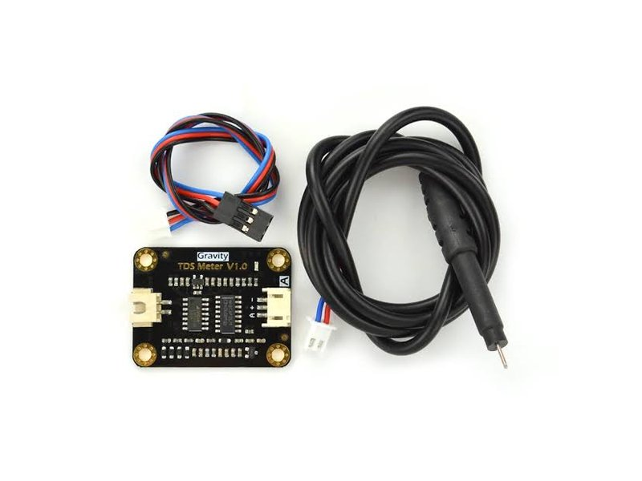 | 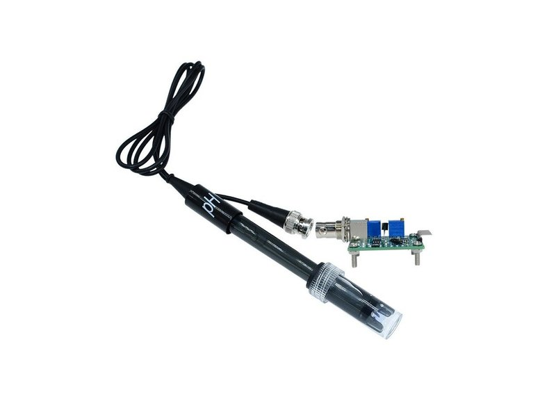 |
| 🎥 **IMX179** — telecamera 8MP<br>night-vision in sfera subacquea | 🧪 **TDS** — sonda di salinità<br>ADC, calibrazione su EEPROM | 🔬 **PH-4502C** — sonda di pH<br>ADC, offset su EEPROM |
|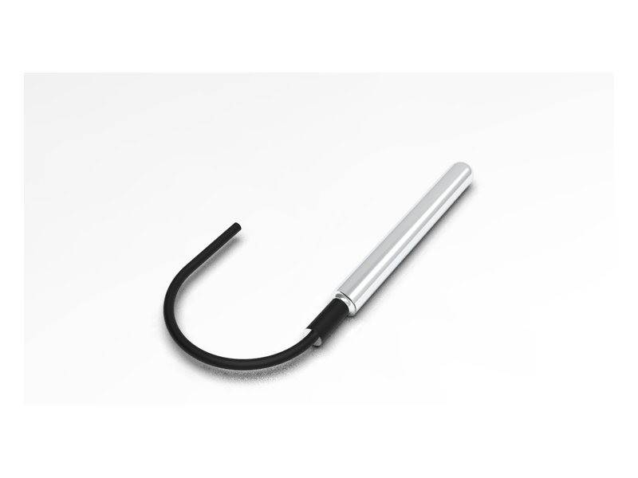 | 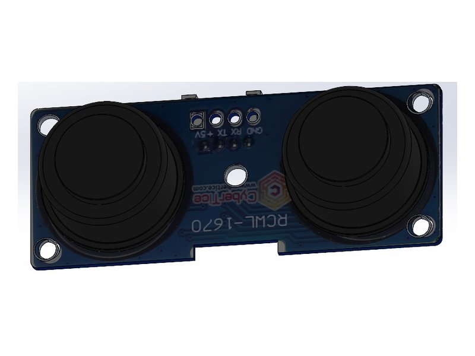 | 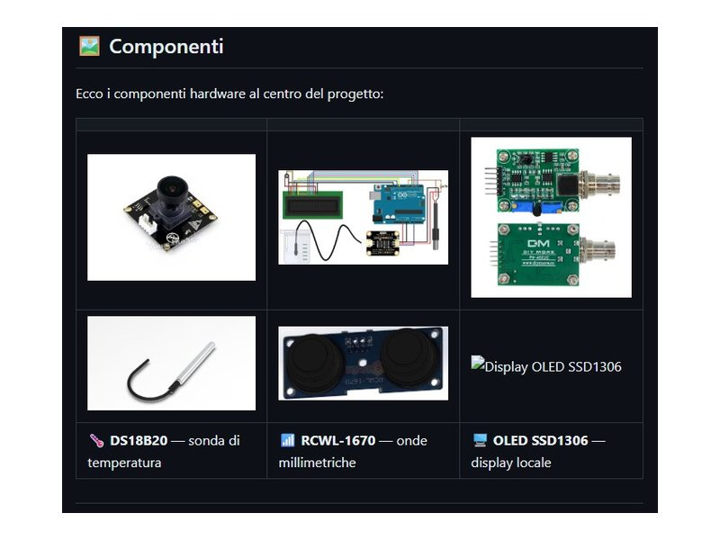 |
| 🌡️ **DS18B20** — sonda di temperatura<br>bus OneWire | 📶 **RCWL-1670** — onde millimetriche<br>rilevamento livello acqua | 🖥️ **OLED SSD1306** — display locale<br>128×64 I²C |
| 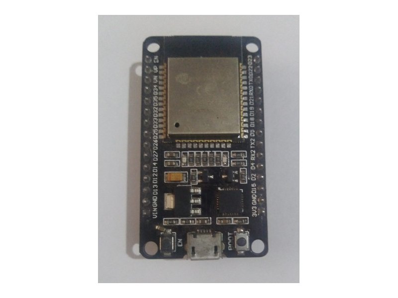 | 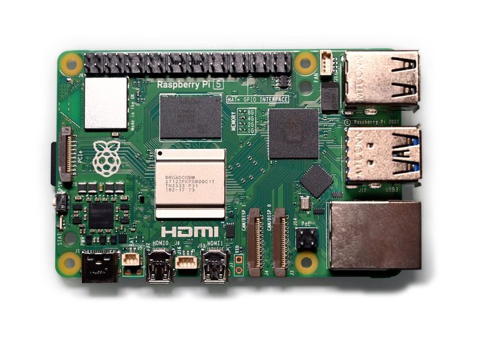 | |
| 🧠 **ESP32-S3** — microcontrollore<br>lettura sensori + OLED | 🍓 **Raspberry Pi** — hub centrale<br>API, storico, video, AI | |

---

## 📄 Licenza

[MIT](LICENSE) — fai pure, contribuisci pure. 🐟
---
